# 🤟 TLS — Documentación Técnica de Implementación
## Sistema Traductor de Lenguaje de Señas · Versión Beta v1.0
**Autor del Proyecto:** Elder Adrián Noriega Ortiz  
**Dirigido a:** Angélica  
**Fecha de Actualización:** 24 de Noviembre de 2026  

---

## 1. Visión General de la Arquitectura: Deletreo Dactilológico Dinámico

El sistema **TLS** implementa un modelo de traducción **estrictamente dactilológico (letra por letra)**:
* **Cero palabras prefabricadas en el diccionario:** El diccionario contiene exclusivamente **letras** del alfabeto dactilológico LSM.
* **Construcción dinámica de palabras:** La aplicación en Android captura cada letra identificada de la mano del usuario mediante la cámara trasera y va encadenando los caracteres para formar palabras en tiempo real.
* **Separación de términos:** El usuario utiliza el botón físico de **Espacio** con el pulgar para delimitar palabras.
* **Emisión de voz por altavoz:** Al pulsar nuevamente el botón central de **Grabar**, Android sintetiza la frase completa construida letra por letra a través del motor `TextToSpeech` (TTS).
* **Recepción Inversa (Voz a Señas):** Cuando la otra persona habla, el motor `SpeechRecognizer` (STT) transcribe la voz a texto y la aplicación descompone la frase **letra por letra**, reproduciendo la secuencia animada de manos en SVG para el usuario sordo.

```mermaid
flowchart TD
    subgraph DeletreoDactilologico ["Deletreo Dinámico (Cámara Trasera)"]
        A["Mano frente a Cámara"] --> B["CameraX Frame (Compensación 90° Sensor)"]
        B --> C["MediaPipe Hand Landmarker (21 Puntos)"]
        C --> D["Vector Binario [Pulgar, Índice, Medio, Anular, Meñique]"]
        D --> E["Identificación de Letra (A, B, C, D, E, F, G, I, L, M, O, P, U, V)"]
        E --> F["Concatenación Letra por Letra en Buffer"]
        F --> G["Botón Espacio entre palabras"]
        G --> H["Text-to-Speech (TTS) Reproduce Frase Completa"]
    end

    subgraph RecepcionVoz ["Recepción Inversa (Micrófono)"]
        I["Voz de la Persona Oyente"] --> J["SpeechRecognizer STT"]
        J --> K["Texto en Español"]
        K --> L["Descomposición Letra por Letra"]
        L --> M["Reproducción de SVGs Anatómicos de Manos"]
    end
```



---

## 2. Corrección de Desalineación del Esqueleto y Eliminación Total de Lag

### 2.1 Causa Raíz de la Desalineación
En la captura de prueba previa, el esqueleto aparecía rotado 90 grados respecto a la mano física. Esto se debía a que los sensores de cámara en Android entregan el búfer de imagen en su orientación nativa apaisada (`Landscape`), requiriendo una rotación de compensación en pantallas verticales (`Portrait`).

### 2.2 Solución en Código
Se aplica una matriz de rotación y escalado antes de la inferencia de MediaPipe:
```kotlin
val matrix = Matrix()
if (rotationDegrees != 0) {
    matrix.postRotate(rotationDegrees.toFloat())
}
// Escala a resolución optimizada (360px) para latencia menor a 18ms
val scale = 360f / bitmap.width.toFloat()
matrix.postScale(scale, scale)

val rotatedBitmap = Bitmap.createBitmap(
    bitmap, 0, 0, bitmap.width, bitmap.height, matrix, true
)
```

### 2.3 Eliminación de Lag (30+ FPS continuos)
Para evitar que se acumulen fotogramas en cola en el procesador, se implementó un control de exclusión mutua no bloqueante con `AtomicBoolean`:
```kotlin
if (isProcessing.compareAndSet(false, true)) {
    try {
        val result = recognizer.processFrame(bitmap, rotationDegrees)
        // Actualización de landmarks en pantalla
    } finally {
        isProcessing.set(false)
        imageProxy.close()
    }
} else {
    imageProxy.close() // Descarte instantáneo de frames redundantes
}
```

---

## 3. Ilustraciones SVG Anatómicas Realistas (Sin Emojis)

Siguiendo las instrucciones del autor:
* **Prohibición absoluta de emojis:** No se usan emojis del sistema.
* **Gráficos Vectoriales Anatómicos:** Se diseñaron 14 archivos SVG en `assets/dictionary/es-LSM/*.svg` utilizando curvas Bézier orgánicas (`<path d="...">`), con siluetas anatómicas reales de manos, articulaciones de falanges y uñas definidas en colores terracota, beige cálido y naranja.

---

## 4. Las 14 Letras del Diccionario Beta LSM

| # | Letra | Tipo | Vector Físico $[P, I, M, A, m]$ | Descripción Anatómica |
|---|---|---|---|---|
| 1 | **A** | Vocal | `[1, 0, 0, 0, 0]` | Puño cerrado con pulgar apoyado al costado del índice |
| 2 | **B** | Consonante | `[0, 1, 1, 1, 1]` | 4 dedos extendidos juntos hacia arriba, pulgar sobre la palma |
| 3 | **C** | Consonante | `[1, 1, 0, 0, 0]` (Arco) | Mano curvada de perfil formando el arco de la C |
| 4 | **D** | Consonante | `[0, 1, 0, 0, 0]` | Índice extendido arriba, los demás tocan el pulgar |
| 5 | **E** | Vocal | `[0, 0, 0, 0, 0]` | Dedos doblados hacia la palma mostrando las uñas |
| 6 | **F** | Consonante | `[0, 0, 1, 1, 1]` | Pulgar e índice en círculo, 3 dedos arriba |
| 7 | **G** | Consonante | `[1, 1, 0, 0, 0]` (Horizontal) | Índice y pulgar extendidos hacia el lado |
| 8 | **I** | Vocal | `[0, 0, 0, 0, 1]` | Solo dedo meñique levantado hacia arriba |
| 9 | **L** | Consonante | `[1, 1, 0, 0, 0]` | Pulgar e índice en ángulo recto formando una L |
| 10 | **M** | Consonante | `[0, 0, 0, 0, 0]` (3 dedos) | Tres dedos doblados sobre el pulgar |
| 11 | **O** | Vocal | Círculo cerrado | Todos los dedos curvados tocando la punta del pulgar |
| 12 | **P** | Consonante | `[1, 1, 1, 0, 0]` (Abajo) | Índice al frente y medio hacia abajo con pulgar |
| 13 | **U** | Vocal | `[0, 1, 1, 0, 0]` (Juntos) | Índice y medio extendidos juntos hacia arriba |
| 14 | **V** | Consonante | `[0, 1, 1, 0, 0]` (Separados) | Índice y medio extendidos separados en V |

---

## 5. Barra de Navegación: Burbuja Colimadora con Lente de Vidrio

* **Desplazamiento horizontal:** El colimador viaja de extremo a extremo suavemente con física de resorte (`Spring.DampingRatioMediumBouncy`).
* **Vidrio Translúcido:** Gradiente radial con reflejo ámbar/beige, borde anaranjado brillante de 2.2dp y 4 marcas de mira telescópica en cruz.
* **Aumento Óptico (Zoom 1.38x):** El icono situado debajo de la lente de vidrio aumenta de tamaño simulando efecto de lupa.
